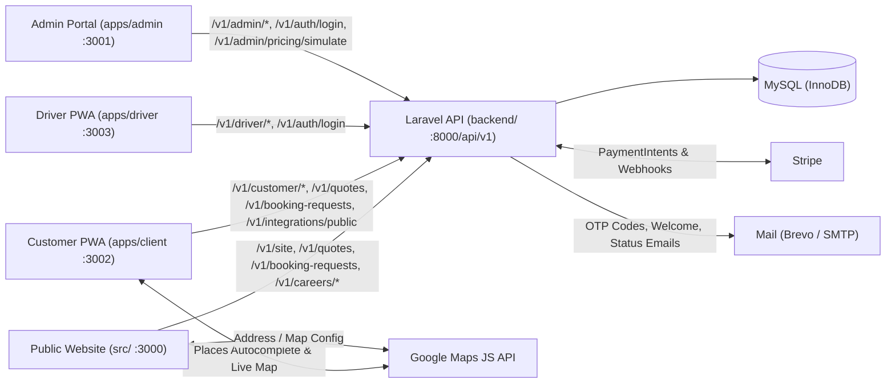

# Archer Executive Services — End-to-End QA Documentation

> **Scope & Authority:** Every rule, route, calculation, status transition, and linkage in this document is derived directly from the live codebase (`backend/`, `src/`, `apps/admin/`, `apps/client/`, `apps/driver/`). Nothing is assumed. Where the codebase marks a rule as founder-directed or subject to commercial sign-off, it is explicitly noted.

---

## 1. Platform Overview & How All Four Applications Interlink

The platform consists of **four Next.js applications** communicating with **one authoritative Laravel REST API** (`backend/`, base path `/api/v1`) backed by **MySQL (InnoDB)**.

| Application | Directory | Default Dev Port | Purpose |
|---|---|---|---|
| **Public Marketing Website** | `src/` | `3000` | Public landing pages, service descriptions, fleet & tier showcase, public booking intake forms, careers portal. |
| **Admin & Operations Portal** | `apps/admin/` | `3001` | Central dispatch, ride management, fleet & blockout scheduling, rate matrix & pricing simulator, driver/customer directory, security ops, payments, payroll, CMS, integrations. Also hosts `/my-rides`. |
| **Customer PWA** | `apps/client/` | `3002` | Customer sign-up/login, quote & booking flow, upcoming/past rides, live chauffeur GPS tracking & ETA, EA/PA assistant profiles, security request page. |
| **Driver PWA** | `apps/driver/` | `3003` | Chauffeur online/offline presence, broadcast ride offer feed, ride acceptance, step-by-step ride status updates, GPS location reporting, weekly earnings & payout summary, assigned security shifts, notifications. |
| **Backend API (Authoritative Core)** | `backend/` | `8000` | Single source of truth for pricing, validation, RBAC, ride state machine, dispatch eligibility, security shift eligibility, Stripe payments/webhooks, payroll math, and audit logs. |

### Cross-App Architecture & Data Flow

### How Data Flows Between the Four Frontends
1. **Admin → Public Website & Customer PWA:**
   - Admin configures **Website Content** (`site_content`), **Tiers** (`site_tiers`), **Website Fleet** (`site_vehicles`), **Operational Fleet & Blockouts** (`vehicles`, `vehicle_blockouts`), **Rate Matrix** (`rate_cards`), **Pricing Settings** (`pricing_settings`), and **Integrations** (`integration_settings`).
   - Public Website & Customer PWA fetch `GET /api/v1/site`, `GET /api/v1/fleet-availability`, and `GET /api/v1/integrations/public` so both immediately reflect Admin changes.
2. **Public Website / Customer PWA → Admin & Customer Account:**
   - Submitting a booking (`POST /api/v1/booking-requests`) creates a `ride_requests` row (`status = pending`), creates an `admin_notifications` alert, emails a confirmation, and **auto-links or creates a Customer `users` account** via `CustomerAccounts::forBooking()` (matched by lowercase email).
   - If the booking is `request_type = general` with `service = security`, it also auto-inserts a row into `security_leads` (`source = website`, linked by `ride_request_id`).
3. **Admin Dispatch ↔ Driver PWA:**
   - Admin either **assigns a driver directly** (`PUT /api/v1/admin/rides/{id}`) or **broadcasts** the ride (`POST /api/v1/admin/rides/{id}/broadcast`), which sets `status = broadcast` and sends `driver_notifications` to all eligible drivers.
   - Eligible drivers see the offer in Driver PWA (`GET /api/v1/driver/offers`). The first driver to accept (`POST /api/v1/driver/offers/{rideId}/accept`) locks the ride (`dispatched`) and notifies the customer.
4. **Driver PWA → Customer PWA & Admin Payroll:**
   - As the driver updates ride status (`PUT /api/v1/driver/rides/{rideId}/status`) and posts GPS coordinates (`POST /api/v1/driver/location`), the Customer PWA polls `GET /api/v1/customer/rides/{id}/tracking` to render the live map, driver marker, and ETA.
   - When a ride reaches `completed`, `RideCloseoutMath` computes the financial ledger used by both **Admin Payments & Earnings** (`GET /api/v1/admin/payments-earnings`), **Admin Payroll** (`GET /api/v1/admin/payroll`), and **Driver Earnings** (`GET /api/v1/driver/earnings`).

---

## 2. Authentication, Roles & Security (RBAC)

### Token & Session Model
- **Bearer Token:** 64-character opaque token issued by `ApiToken::issueFor($user)`. Only the SHA-256 hash is stored in `api_tokens`. Default TTL is `API_TOKEN_TTL_MINUTES` (480 minutes).
- **Inactive Users:** Any user whose `status !== 'active'` is rejected at login and on token verification.
- **No Frontend Trust:** Permissions are computed server-side per request via `RequirePermission` middleware (`permission:<key>`).

### Staff & Driver Authentication (`/api/v1/auth/*`)
| Endpoint | Auth | Rate Limit | Behavior |
|---|---|---|---|
| `POST /auth/login` | None | `login` (5/min) | Email + password. Unknown user, bad password, and inactive user all return identical `401 INVALID_CREDENTIALS`. |
| `POST /auth/logout` | Bearer | — | Revokes only the presented token. |
| `GET /auth/me` | Bearer | — | Returns user profile, `roles`, and `permissions`. |
| `POST /auth/password/forgot` | None | `password-recovery` | Always returns `202` (no account enumeration). |
| `POST /auth/password/reset` | None | `password-recovery` | Resets password and revokes all existing `apiTokens` for that user. |

### Customer Authentication (`/api/v1/customer/auth/*` + `/api/v1/auth/login`)
Customers have **three ways** to authenticate, all issuing the same Bearer token with the `customer` role (`self.profile` permission):
1. **Direct Registration (`POST /customer/auth/register`):** Name, email, optional phone, password (min 10 chars, letters + numbers, confirmed). Returns `422 ACCOUNT_EXISTS` if email already exists.
2. **Passwordless Emailed 6-Digit Code (`POST /customer/auth/code` → `POST /customer/auth/code/verify`):**
   - `requestCode`: Returns `404 ACCOUNT_NOT_FOUND` if no `customer` role account exists for that email. Voids prior unconsumed codes, generates a 6-digit code (`LoginCode`), and emails it.
   - `verifyCode`: Enforces `LoginCode::MAX_ATTEMPTS` and expiry (`LoginCode::TTL_MINUTES`). Optionally accepts a `password` in the same step (validated before consuming the code) and revokes other sessions if a password is set.
3. **Email + Password (`POST /auth/login`):** Works once the customer has registered with a password or set one via `PUT /customer/password`.
4. **Booking Auto-Account (`CustomerAccounts::forBooking`):** When a guest books on the Public Website, a `customer` user is created automatically with a random unrecoverable password so they can later sign in via emailed code. **Important:** If the booking email belongs to a **staff account**, `forBooking()` returns `null` so staff accounts never receive customer rides.

### 9-Role RBAC Matrix (`backend/config/rbac.php`)
| Role Key | Display Name | Granted Permissions |
|---|---|---|
| `super_admin` | Super Admin | All permissions except `self.profile` (26 permissions). |
| `operations_manager` | Operations Manager | `dashboard.view`, `rides.view`, `rides.manage`, `dispatch.manage`, `drivers.view`, `drivers.manage`, `tiers.manage`, `fleet.manage`, `pricing.manage`, `payments.view`, `reports.view`, `audit.view`, `settings.manage`, `security.view`, `security.manage`, `careers.view`, `careers.manage`. |
| `dispatcher` | Dispatcher | `dashboard.view`, `rides.view`, `rides.manage`, `dispatch.manage`, `drivers.view`, `security.view`. |
| `driver_manager` | Driver Manager | `dashboard.view`, `drivers.view`, `drivers.manage`, `drivers.switches`, `tiers.manage`, `security.view`, `careers.view`, `careers.manage`. |
| `finance_payroll` | Finance/Payroll | `dashboard.view`, `rides.view`, `drivers.view`, `payments.view`, `payments.manage`, `payroll.view`, `payroll.manage`, `reports.view`, `audit.view` *(audit restricted to `payment.*` and `payroll.*` events)*. |
| `content_editor` | Content Editor | `content.edit`. |
| `content_publisher` | Content Publisher | `content.edit`, `content.publish`. |
| `driver` | Driver | `self.profile`, `driver.portal`. |
| `customer` | Customer | `self.profile`. |

### Data Isolation & Safety Rules
- **Customer Isolation:** `CustomerPortalController` scopes all ride queries to `customer_id = $request->user()->getKey()` and assistant profiles to `email = $request->user()->email`. Accessing another customer's ride returns `404`.
- **Driver Isolation:** `DriverPortalController` resolves the driver by `user_id` (falling back to `email`). In non-production environments only, if `config('archer.allow_driver_preview')` is `true`, `super_admin`, `operations_manager`, or `dispatcher` can preview the first driver's read-only views (never in `production`, and mutations like `acceptOffer` / `updateRideStatus` / `updatePresence` / `updateLocation` still require a real driver profile).
- **Audit Trail (`audit_logs`):** Append-only table. Records logins, failed logins, profile updates, booking creation, status transitions, driver assignments, rate/pricing changes, security CRUD, Stripe intents/webhooks, and customer views (`customer.viewed`).

---

## 3. Services, Tiers, Vehicles & Fleet Availability

### A. Services & Booking Request Types
1. **Pricing Engine Services (`PricingSetting::SERVICES`):**
   - `hourly` — Hourly Chauffeur
   - `airport` — Airport Transportation
   - `p2p` — Point-to-Point
   - `client` — Client Car Service (chauffeur drives the client's own vehicle)
   - `security` — Standalone Security Staffing
2. **Public Booking Request Types (`POST /api/v1/booking-requests`):**
   | `request_type` | Reference Prefix | Stored `service_type` | Special Behavior |
   |---|---|---|---|
   | `general` | `ARC-XXXXXX` | `hourly`, `airport`, `p2p`, `client`, or `security` | If `service = security`, also creates a `security_leads` record. |
   | `point_to_point` | `P2P-XXXXXX` | `p2p` | Supports `way`: `one` or `round` (requires `return_time`). |
   | `airport` | `AIR-XXXXXX` | `airport` | Supports `direction`: `from` or `to`, `meet`: `curb` or `sign`, `flight_number` required. |
   | `client_car` | `CCS-XXXXXX` | `client-car` | Requires `vehicle_make`, `vehicle_model`, `hours` (3–24), `vehicle_confirmed` accepted. |
   | `concierge` | `CON-XXXXXX` | `concierge` | Email optional; `driver_tier` defaults to `'1'`. |
   | `assistant_week` | `WEEK-XXXXXX` | `assistant-week` | Accepts 1–12 `rides[]` for an executive's weekly schedule. |
   | *(Admin Phone)* | `AR-XXXX` | Any | Created via `POST /api/v1/admin/rides` (`request_type = phone`). |

### B. Tiers (`site_tiers`)
Tiers are separated by `kind`: `driver` (chauffeur tiers) and `security` (security staffing tiers).
Default seeded tiers (`SiteContentSeeder`):
| Tier # | `driver` Kind Label & Title | `security` Kind Label & Title | `call_only` |
|---|---|---|---|
| **1** | `TIER 1 · ESSENTIAL` — Professional Chauffeur | `TIER 1 · ESSENTIAL` — Security Officer | `false` |
| **2** | `TIER 2 · EXECUTIVE` — Military & Law-Enforcement Chauffeur | `TIER 2 · EXECUTIVE` — Security Specialist | `false` |
| **3** | `TIER 3 · ELITE` — Executive Protection Specialist | `TIER 3 · ELITE` — Executive Protection Specialist | `false` |
| **4** | `TIER 4 · ARMED` — Senior Protection Specialist | `TIER 4 · ARMED` — Senior Protection Specialist | **`true`** |

- **QA Rule:** Any tier with `call_only = true` or `is_active = false` is **rejected** by `PublicBookingController` validation. `QuoteService` also rejects inactive tiers (`TIER_UNAVAILABLE`).
- **Delete Guard:** A `driver` tier cannot be deleted if any `Driver` has `service_tier = tier` (`409 TIER_IN_USE`).

### C. Vehicle Catalog & Fleet Availability Linkage
There are **three** vehicle/catalog layers that must align:
1. **Rate Classes & Sizes (`rate_classes`, `rate_sizes`):**
   - Seeded classes: `exec` (Executive Class), `first` (1st Class).
   - Seeded sizes: `sedan` (Mid-Size / Compact SUV), `suv` (Full-Size SUV), `van` (Sprinter).
   - Admin can add/retire/activate/delete classes and sizes via `/api/v1/admin/site-rates/*`. Retiring a class/size deactivates its `rate_cards` and `site_vehicles`. Deleting is blocked if `ride_requests` history exists.
2. **Marketing Fleet (`site_vehicles`):**
   - Stores display name, blurb, image, passenger/bag capacity for the website showcase:
     - `exec|sedan`: Chevrolet Traverse
     - `exec|suv`: Chevrolet Suburban
     - `exec|van`: Mercedes-Benz Sprinter
     - `first|sedan`: Lincoln Aviator
     - `first|suv`: Cadillac Escalade
     - `first|van`: Executive Sprinter
3. **Operational Fleet (`vehicles` + `vehicle_blockouts`):**
   - Managed in **Admin → Fleet & Availability** (`/api/v1/admin/fleet/*`).
   - **Authoritative Gate (`OperationalFleet` & `FleetAvailability`):**
     - A `class|size` combination is only bookable/quotable if **at least one active `Vehicle`** maps to it (`is_active = true`).
     - Capacity check (`OperationalFleet::fits`): rejects quote with `422 OVER_CAPACITY` if `passengers > vehicle.passengers` or `bags > vehicle.luggage`.
     - Time/Schedule check (`FleetAvailability::options($date, $time, $hours)`): a `class|size` is marked unavailable if **every** matching active `Vehicle` is either:
       - `is_out_of_service = true` (returns `"Out of service"`), OR
       - Requested day is not in `available_days`, OR
       - Requested `[start, end)` window falls outside `available_from`..`available_until`, OR
       - Requested `[start, end)` overlaps any `vehicle_blockouts` record (`start < block.end_at && end > block.start_at`) (returns `"Not available at this time"`).
     - Plates and blockout details are **never** exposed in public payloads (`/v1/site`, `/v1/fleet-availability`).

---

## 4. Pricing Engine & Exact Price Calculation

### Authoritative Calculator (`App\Support\Pricing\QuoteService`)
- **Endpoints:** `POST /api/v1/quotes` (public, throttled 60/min) and `POST /api/v1/admin/pricing/simulate` (Admin). Both execute the exact same `QuoteService::quote()`.
- **Rule Version:** `pricing-2026-11-15`.
- **Arithmetic:** All calculations use **integer cents**. Percentages use basis points (`bp`, where `100 bp = 1%`), rounded half-up: `intdiv($cents * $bp + 5000, 10000)`.
- **No Guessing:** If a `RateCard` is missing or `is_active = false`, `QuoteService` throws `422 RATE_NOT_CONFIGURED`. If a service is inactive, it throws `422 SERVICE_UNAVAILABLE`.
- **Authority:** `PublicBookingController` **never** accepts or stores client-submitted prices/totals; bookings are saved as `pending` for dispatch confirmation.

### Seeded Rate Cards (`SiteContentSeeder`, USD/hour or USD/trip)
| Kind | Class \| Size | Tier 1 | Tier 2 | Tier 3 | Tier 4 |
|---|---|---|---|---|---|
| `hourly` (per hr) | `exec \| sedan` (Traverse) | \$70 | \$90 | \$130 | \$190 |
| `hourly` (per hr) | `exec \| suv` (Suburban) | \$80 | \$100 | \$140 | \$215 |
| `hourly` (per hr) | `exec \| van` (Sprinter) | \$175 | \$195 | \$235 | \$390 |
| `hourly` (per hr) | `first \| sedan` (Aviator) | \$80 | \$100 | \$140 | \$210 |
| `hourly` (per hr) | `first \| suv` (Escalade) | \$100 | \$120 | \$160 | \$235 |
| `hourly` (per hr) | `first \| van` (Exec Sprinter) | \$225 | \$245 | \$285 | \$475 |
| `point_to_point` (flat) | `exec \| sedan` | \$145 | \$170 | \$215 | \$270 |
| `point_to_point` (flat) | `exec \| suv` | \$155 | \$180 | \$225 | \$280 |
| `point_to_point` (flat) | `first \| sedan` | \$155 | \$180 | \$225 | \$280 |
| `point_to_point` (flat) | `first \| suv` | \$200 | \$220 | \$260 | \$310 |
| `security_hourly` (per guard-hr) | *(no vehicle)* | \$45 | \$60 | \$75 | \$125 |
| `client_car_hourly` (per hr) | *(no vehicle)* | \$45 | \$60 | \$75 | \$125 |

*(Note: `van` has no `point_to_point` flat rate; Sprinters always price hourly.)*

### Migration-Seeded `pricing_settings` Defaults
- **All services:** `booking_fee_cents = 1000` (\$10.00), `gratuity_suggested_bp = 2000` (20%), `tax_bp = 0` (configurable in Admin), `card_fee_bp = 0` (configurable in Admin), `is_active = true`.
- **`hourly`:** `pricing_mode = 'hourly'`, `min_hours = 4`, `max_stops = 5`.
- **`client`:** `pricing_mode = 'hourly'`, `min_hours = 3`, `max_stops = 5`.
- **`security`:** `pricing_mode = 'hourly'`, `min_hours = 3`, `max_stops = 5`.
- **`airport` & `p2p`:** `pricing_mode = 'flat'`, `van_hourly = true`, `min_hours = 4`, `included_stops = 1`, `stop_fee_cents = 2000` (\$20.00), `max_stops = 3`, `guard_min_hours = 3`.

### Step-by-Step Quote Calculation Logic
1. **Airport `OTHER` Special Case:**
   - If `service === 'airport'` and `airport_code === 'OTHER'`, returns immediately with `dispatch_will_quote: true`, `dispatch_note: 'Dispatch will quote'`, `total_cents: 0`, `lines: []`.
2. **Base Fare Line (`code: 'base'`):**
   - **`security`:** `guards = max(1, in.guards)`, `hours = max(in.hours, min_hours)`. Uses `security_hourly` rate for `tier`. Amount = `rate * guards * hours`.
   - **`client`:** `hours = max(in.hours, min_hours)`. Uses `client_car_hourly` rate for `tier`. Amount = `rate * hours`.
   - **Vehicle Services (`hourly`, `airport`, `p2p`):**
     - Checks `OperationalFleet::active($class, $size)` and capacity (`passengers`, `bags`).
     - **NJ vs NY/PA Airport Check (`ServiceAreas`):**
       - Default NJ (`region = 'nj'`): `EWR`, `ACY`, `TEB`, `MMU`.
       - Default NY/PA (`region = 'ny_pa'`): `JFK`, `LGA`, `PHL`.
     - **Sprinter Hourly Override (`$vanHourly`):** True when `(flat && size === 'van' && van_hourly)` OR `(isAirport && size === 'van')`.
     - **Branch A — Flat Trip (`flat && !vanHourly && !isNyPaAirport`):**
       - Uses `point_to_point` rate. `tripMultiplier = round_trip ? 2 : 1`. Sets `is_from_price = true`.
     - **Branch B — Per Mile (`service !== 'hourly' && pricing_mode === 'per_mile'`):**
       - Requires `miles >= 1` (`DISTANCE_REQUIRED` if missing). Applies `max(miles, min_miles)`, doubles if `round_trip`. Uses `per_mile` rate.
     - **Branch C — Hourly (Hourly service, NY/PA airports, or any Sprinter):**
       - If `isNyPaAirport` or `vanHourly`: `baseHours = max(4, in.hours ?? 4)` (4-hour minimum). Otherwise `max(in.hours, min_hours)`.
       - `hours = round_trip ? baseHours * 2 : baseHours`. Uses `hourly` rate.
3. **Security Add-On Line (`code: 'security'`, when `guards > 0` on a vehicle ride):**
   - Validates `security_tier` (defaults to ride `tier`) against active `security` tiers.
   - If `service !== 'hourly'` (trip): `minGuardHours = (size === 'van') ? 4 : (guard_min_hours ?: 3)`. `baseGuardHours = max(in.guard_hours, minGuardHours)`, doubled if `round_trip`.
   - If `service === 'hourly'`: `guardHours = (guard_hours_mode === 'ride' && hours !== null) ? hours : in.guard_hours`, clamped to `>= guard_min_hours`.
   - Amount = `security_hourly(security_tier) * guards * guardHours`.
4. **Stops, Passengers, Bags & FBO/Hotel Surcharge:**
   - Rejects with `422 TOO_MANY_STOPS` if `max_stops !== null && stops > max_stops`.
   - **Sprinter on a trip (`$vanHourly`):** All stops are included (`stop_fee = 0`).
   - Otherwise: `extra_stops = max(0, stops - included_stops) * stop_fee_cents`.
   - `extra_passengers = max(0, passengers - included_passengers) * per_passenger_cents`.
   - `extra_bags = max(0, bags - included_bags) * per_bag_cents`.
   - **FBO & Hotel (`is_fbo_hotel = true` or `booking_type = 'fbo_hotel'`):** Adds `2495` cents (\$24.95) once per booking (`code: 'service_charge'`).
5. **Totals & Suggested Gratuity:**
   - `subtotal_cents = sum(lines.amount_cents)`
   - `booking_fee_cents = s.booking_fee_cents`
   - `tax_cents = percent(subtotal + (tax_includes_fees ? booking_fee : 0), s.tax_bp)`
   - `card_fee_cents = percent(subtotal + booking_fee + tax, s.card_fee_bp)`
   - `total_cents = subtotal + booking_fee + tax + card_fee`
   - `gratuity_suggested_cents = percent(subtotal, s.gratuity_suggested_bp)` *(returned for display only; `gratuity_included = false`, NOT added to `total_cents`)*.

### Closeout, Chauffeur Pay & Payroll Math (`RideCloseoutMath`, `ChauffeurPay`, `PayrollController`)
- **Chauffeur Hourly Pay (`ChauffeurPay`):** Reads `site_tiers.pay_cents` for `kind = 'driver'`; if unset, falls back to published rates: **T1 = \$25/hr**, **T2 = \$30/hr**, **T3 = \$35/hr**, **T4 = \$55/hr**.
- **Security Hourly Pay (in `RideCloseoutMath::resolveCloseoutDetails` fallback):** T1 = \$30/hr, T2 = \$40/hr, T3 = \$50/hr, default = \$40/hr.
- **Closeout Ledger (`RideCloseoutMath::ledgerRow`):**
  - `taxable_base = max(0, fare - promo + extra_time)`
  - `client_paid = taxable_base + booking_fee + tax + tip`
  - `card_fee`: \$0 if `payment_method === 'Cash'`, else `round(client_paid * (card_fee_bp / 10000), 2)`
  - `archer_profit = round(client_paid - tax - card_fee - driver_pay - security_pay - tip, 2)`
- **Weekly Payroll (`PayrollController` & `DriverEarningsSummary`):**
  - `gross_earnings = sum(driver_pay + tip)` for completed rides in the pay week.
  - `cash_deductions = sum(client_paid)` for rides where `payment_method === 'Cash'`.
  - `net_amount = round(gross_earnings - cash_deductions, 2)`:
    - `> 0`: `ready` ("Archer owes driver \$X")
    - `< 0`: `carried_forward` ("Driver owes Archer \$X — cash kept exceeds pay")
    - `= 0`: `zero`
    - Disbursement recorded in `payroll_disbursements` changes status to `paid`.

---

## 5. Ride State Machine, Dispatch & Real-Time Tracking

### Authoritative Ride Status Graph (`App\Support\RideStateMachine`)
Aliases normalized before checking transitions:
- `at_your_doorstep` → `at_doorstep`
- `driver_assigned` → `dispatched`
- `accepted` → `dispatched`

Allowed transitions (`canTransition`):
| Current Status | Allowed Next Statuses |
|---|---|
| `new` | `pending`, `broadcast`, `dispatched`, `cancelled` |
| `pending` | `new`, `broadcast`, `dispatched`, `cancelled` |
| `broadcast` | `dispatched`, `pending`, `cancelled` |
| `dispatched` | `on_my_way`, `in_progress`, `ride_started`, `cancelled`, `broadcast` |
| `on_my_way` | `at_doorstep`, `ride_started`, `in_progress`, `cancelled` |
| `at_doorstep` | `ride_started`, `in_progress`, `cancelled` |
| `ride_started` | `in_progress`, `ride_ended`, `completed`, `cancelled` |
| `in_progress` | `ride_ended`, `close_out`, `completed`, `cancelled` |
| `ride_ended` | `close_out`, `completed`, `cancelled` |
| `close_out` | `completed`, `cancelled` |
| `completed` | *(terminal — none)* |
| `cancelled` | *(terminal — none)* |

*(Any illegal transition returns `422 ILLEGAL_STATUS_TRANSITION`.)*

### Client Car Dispatch Safety Lock
In `RideDispatchController::update`, if `service_type` is `client-car` or `client_car` and a driver is being assigned, the API blocks the assignment with `422 CLIENT_CAR_AGREEMENT_REQUIRED` unless `details['is_client_car_signed']` is truthy (set via `POST /api/v1/admin/rides/{id}/record-agreement`) or `override_agreement = true` is passed.

### Broadcast & Driver Offer Eligibility (`DriverOfferEligibility`)
A driver qualifies to see and accept a `broadcast` ride if and only if:
1. `driver.is_active === true`
2. `driver.service_tier !== null` and **`driver.service_tier <= ride.driver_tier`**
3. **Operating Switch Match:**
   - If `ride.service_type` contains `'client'`: `driver.is_client_car_operator === true`
   - Otherwise: `driver.is_fleet_operator === true`
- **Concurrency:** `DriverPortalController::acceptOffer` uses `DB::transaction` + `lockForUpdate()`. If another driver already took the ride, it returns `409 OFFER_UNAVAILABLE`.

### Live GPS Tracking & ETA
1. Driver PWA sends `POST /api/v1/driver/location` (`lat`, `lng`, optional `heading`, `speed`, throttled 60/min), updating `drivers.current_lat`, `current_lng`, `last_location_at`.
2. Customer PWA calls `GET /api/v1/customer/rides/{id}/tracking`.
3. `is_live` is `true` only when `ride.status` is in `['on_my_way', 'at_doorstep', 'at_your_doorstep', 'ride_started', 'in_progress']`.
4. **Target Coordinate:** Before pickup (`on_my_way`, `at_doorstep`), ETA targets `pickup_lat/lng`. Once `ride_started` or `in_progress`, ETA targets `dropoff_lat/lng`.
5. **ETA Formula (`calculateEstimatedMinutes`):** Straight-line Haversine distance in miles divided by **25 mph**, converted to minutes (`ceil((miles / 25) * 60)`), minimum `1` minute.

---

## 6. Location, Google Maps & Service Areas

### Google Maps Configuration (`GET /api/v1/integrations/public`)
- Configured in **Admin → Settings → Integrations** (`integration_settings` table, falls back to `.env` `GOOGLE_MAPS_BROWSER_KEY`).
- Public endpoint returns **only** publishable fields (never `google_maps_server_key` or secret keys):
  - `google_maps_browser_key`
  - `google_maps_country_codes` (default `['us']`)
  - `google_maps_service_area`: `label`, `center_lat`, `center_lng`, `radius_km`, `strict_bounds`
- **Frontend Usage:**
  - `LocationAutocompleteInput.tsx` loads Google Maps JS `places` library, applies country/bounds restrictions, and captures `lat`/`lng` via `PlacesService.getDetails` on selection.
  - `CustomerLiveMap.tsx` renders `google.maps.Map` with `DirectionsService` driving route and markers for pickup, dropoff, and live driver position.

### Service Areas (`App\Support\ServiceAreas`)
Stored on `site_content` (`key = 'settings'`), with fallback defaults:
- **Airports:**
  - `nj` region: `EWR`, `ACY`, `TEB`, `MMU`
  - `ny_pa` region: `JFK`, `LGA`, `PHL` (triggers 4-hour minimum hourly pricing in `QuoteService`)
  - `other` region: `OTHER` (triggers `"Dispatch will quote"`, \$0 estimate)
- **Security Venues:** `Religious buildings`, `Office / corporate`, `Corporate events`, `Private events`, `Daycares & camps`, `Schools`, `Production sets`, `Retail / commercial`.

---

## 7. Security Operations Module (Phase 2)

*(Note: Per `docs/SECURITY_OPERATIONS_RULES.md`, these rules are server-enforced in `SecuritySuiteController` and `ShiftEligibility` as founder-directed working assumptions pending final commercial sign-off.)*

### Lifecycle
`Website Security Booking / Admin Manual Entry` → **Lead** (`security_leads`) → **Convert** → **Contract** (`security_contracts`) → **Generated Shifts** (`security_shifts`) → **Driver Assignment** → **Optional Swap** (`security_swaps`)

1. **Leads:**
   - Statuses: `new → contacted → in_progress → converted | lost`.
   - `converted` can only be set by `POST /api/v1/admin/security/leads/{id}/convert` (creates contract + shifts atomically, locks lead from edit/delete/reversion).
2. **Contracts & Shift Generation:**
   - Generates one shift per guard slot (`headcount`) for each allowed weekday in `length_days` (max 90).
   - Wall-clock times are parsed in **`America/New_York`** and stored in **UTC** (`starts_at`, `ends_at`).
   - **14-Day Release Horizon:** Shifts starting within 14 days are `open`; later shifts are `not_released_yet`.
   - Cancelling a contract cancels unassigned shifts and future assigned shifts (notifying assigned drivers). Deleting a contract is blocked if any shift was ever assigned.
3. **Shift Assignment Eligibility (`ShiftEligibility::problems`):**
   A driver can be assigned to a shift only if **all 4** hold:
   1. Driver exists and `is_active === true`.
   2. `driver.service_tier >= shift.tier` (T1..T4).
   3. No `security_credentials` row for that driver is `suspended`, or expires before the shift (`expires_at < shift.starts_at`).
   4. No overlapping `assigned` or `swap_pending` security shift exists for that driver.
4. **Credentials Status:**
   - Computed priority: `suspended` (manual) > `expired` (past `expires_at`) > `renewal_due` (within **30 days**) > `valid`.
   - System flags impacted future shifts; it does **not** auto-unassign.
5. **Swaps:**
   - Requires an `assigned` future shift and an eligible target driver; sets shift to `swap_pending` (1 pending swap per shift).
   - `approve` re-checks eligibility transactionally and transfers the shift; `deny` or `withdraw` restores `assigned` to the original driver. Decided swaps are final (`409`).
6. **Announcements:**
   - Posting an announcement fans out a `driver_notifications` (`type = 'security'`) record to every active driver.

---

## 8. Payments (Stripe) & Careers

### Stripe Payments
- **Create Intent:** `POST /api/v1/admin/payments/stripe/intent` (`payments.manage`). Reads `stripe_secret_key` from `integration_settings` (or `.env`), creates a Stripe `PaymentIntent` with `metadata: { ride_id, ride_reference }`, and saves `stripe_payment_intent_id` on `ride.details`.
- **Webhook:** `POST /api/v1/webhooks/stripe` (unauthenticated, throttled 120/min). Verifies `Stripe-Signature` against `resolvedStripeWebhookSecret()`. Deduplicates via `stripe_webhook_events.stripe_event_id`. On `payment_intent.succeeded` or `charge.succeeded`, matches ride by metadata `ride_id` / `ride_reference` and sets `details.payment_status = 'paid'`.

### Careers Flow
- **Public:** `GET /v1/careers/status`, `/tiers`, `/jobs`, `/jobs/{slug}`, `POST /v1/careers/jobs/{id}/apply` (with document uploads), `POST /v1/careers/track`.
- **Admin:** `AdminCareerJobController` & `AdminCareerApplicationController`. Includes one-click **`POST /api/v1/admin/careers/applications/{id}/convert-to-driver`** to onboard a hired applicant into the `drivers` table.

---

## 9. QA Verification Checklist (Critical Paths)

1. **Cross-App Catalog Sync:** Disable a vehicle or tier in Admin → confirm it disappears from `GET /api/v1/site` and is rejected (`422`) by `POST /api/v1/quotes` and `POST /api/v1/booking-requests`.
2. **Fleet Blockout:** Add a blockout or mark a vehicle out of service in Admin → confirm `GET /api/v1/fleet-availability` returns `available: false` for that window and `POST /api/v1/booking-requests` rejects it.
3. **Pricing Matrix & Simulator:** Verify `POST /api/v1/quotes` (Customer/Website) and `POST /api/v1/admin/pricing/simulate` (Admin) return identical `total_cents` for:
   - `p2p` flat vs `van` (Sprinter hourly 4-hr min) vs `round_trip`
   - `airport` NJ (`EWR`) flat vs NY/PA (`JFK`) 4-hr hourly vs `OTHER` (`dispatch_will_quote: true`)
   - `is_fbo_hotel: true` (+\$24.95)
   - `guards > 0` on trip vs hourly
   - `gratuity_suggested_cents` excluded from `total_cents`
4. **Booking → Customer Account Link:** Submit a booking with a new email → confirm `ride_requests` is `pending`, `admin_notifications` is created, and the customer can sign in via `POST /api/v1/customer/auth/code` + `/verify` and see the ride. Confirm a staff email booking does **not** attach the ride to the staff user.
5. **Dispatch & Concurrency:** Broadcast a ride → verify only drivers matching `service_tier <= ride.driver_tier` and operating mode (`is_fleet_operator` vs `is_client_car_operator`) see it in `/v1/driver/offers`. Test two drivers accepting simultaneously: one gets `200`, the second gets `409 OFFER_UNAVAILABLE`.
6. **Client Car Lock:** Attempt to assign a driver to a `client-car` ride without a signed agreement → confirm `422 CLIENT_CAR_AGREEMENT_REQUIRED`. Record agreement → confirm assignment succeeds.
7. **Live Tracking & State Machine:** Progress ride `dispatched → on_my_way → at_doorstep → ride_started → ride_ended → completed` via Driver PWA. Confirm illegal jumps return `422`, and Customer `/tracking` switches ETA target from pickup to dropoff at `ride_started`.
8. **Security Ops:** Submit website `service = security` booking → confirm lead appears in Admin Security Leads → Convert to Contract → confirm shifts generate in ET/UTC with 14-day `open` vs `not_released_yet` → test suspended/expired credential blocking assignment.
9. **Payroll & Stripe:** Complete a Card ride and a Cash ride → verify Admin Payroll deducts Cash `client_paid` from `gross_earnings` and flags negative balance as `carried_forward`. Verify Stripe webhook deduplicates identical `stripe_event_id`.
10. **RBAC Negative Tests:** Verify `dispatcher` cannot access `/admin/payroll` or `/admin/site-rates/matrix` (`403`), `customer` cannot access `/driver/*` or `/admin/*` (`403`), and Customer A cannot view Customer B's ride (`404`).
